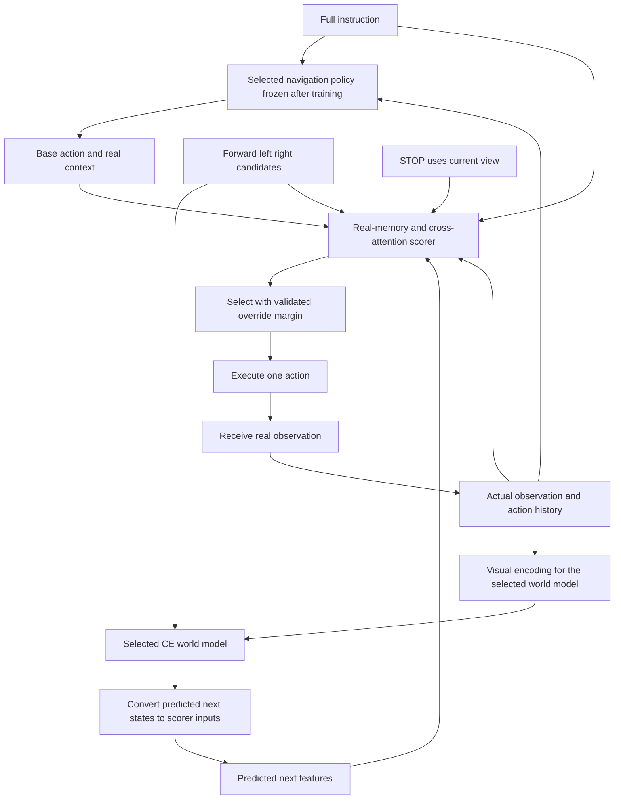

# CE World Model Approach

Design snapshot: 23 October 2026. Three navigation backbone trials are locked; four world-model trial families are agreed. Specific world-model checkpoint and size choices remain open.

**Our approach:** train three lightweight navigation policies using a StreamVLN-style recipe, then freeze each policy for the world-model experiments. The first scorer version evaluates FORWARD, LEFT, RIGHT, and STOP using one-action predictions, instruction features, and memory of the real journey. Compare both DINO-feature and CDiT world models, with and without transferred dynamics weights. Execute one selected action, observe what actually happens, and repeat. The policy supplies its preferred action and real-context features; the scorer overrides that action only under a development-validated rule.

The architecture is our current working design. Scorer and world-model interface fixes are implemented, with CPU tests of the scorer and pinned DINO/CDiT/diffusion source. Actual pretrained policy/encoder/WM integration, CE training, benchmark validation, and a defensible novelty claim remain pending. See [Architecture Compatibility](Architecture_Compatibility.md) and [Scorer Design](Scorer_Design.md). The supporting literature investigation has a cutoff of 22 October 2026; architecture sources were checked on 23 October 2026.

## 1 Research question

Can predicted futures help a frozen navigation policy choose actions that better follow an instruction in continuous environments?

The central issue is **whether a prediction preserves the information needed to choose a useful action**. A plausible future view can still lead to the wrong decision if the scorer misunderstands the instruction, loses track of progress, or trusts an inaccurate prediction.

Our working hypothesis is that learning from actual outcomes of alternative CE action sequences can improve this decision process. Whether ordinary feature prediction is sufficient, or whether the world model needs an additional objective tied to action usefulness, remains an experimental question.

## 2 Agreed choices

| Component | Current decision |
| --- | --- |
| Navigation setting | R2R-CE and RxR-CE. CE means continuous environments. |
| Navigation backbones | Locked trials: SmolVLM2-500M, LLaVA-OneVision-0.5B, and Qwen3-VL-2B-Instruct. |
| Policy training | Adapt each pretrained VLM with StreamVLN-style expert trajectory supervision followed by DAgger. Start with LoRA and a frozen policy visual encoder for the 8 GB target. |
| Policy freezing | Freeze each trained navigation policy before training and evaluating the world model and scorer around it. |
| Candidate actions | First version: all four CE primitive actions, with a one-action prediction horizon. Map the common action names to each task configuration. |
| World model | Four trials: DINO-WM transfer, NWM transfer, DINOv2 with new dynamics, and CDiT with new dynamics. These are world-model choices, independent of the three navigation backbones. |
| Visual representation | DINO-feature trials use initially frozen pretrained DINOv2; CDiT trials retain a pretrained VAE, initially frozen. |
| Dynamics initialization | Compare transferred world-model weights with newly initialized dynamics within each family, using matched architectures for initialization claims. |
| Predicted output | DINO trials predict visual patch features; NWM/CDiT trials predict VAE latents that can be decoded to future RGB. A common scorer interface requires an explicit representation adapter. |
| Scorer inputs | Frozen policy instruction/context features, current DINO patches, recurrent real-history memory, candidate action, and predicted next DINO patches. |
| Scorer architecture | Width 256, eight real-memory slots, two candidate attention blocks, and utility/success/collision heads; approximately 2.9–3.2M trainable parameters. Utility selects actions; other heads are auxiliary. |
| Scorer supervision | Actual candidate action followed by frozen-policy continuation; target combines terminal success, whole-path nDTW, remaining actions, and collisions. |
| Instruction splitting | No explicit subinstruction splitter in the first version. |
| Execution | Execute one selected action, receive a real observation, update actual memory, and replan. STOP terminates immediately and needs no world-model prediction. |
| New training data | R2R-CE/RxR-CE training scenes and trajectories collected within that scope. |

This dataset restriction applies to **our added training and evaluation**. The pretrained VLMs, visual encoders, VAE, and transferred world-model weights contain external pretraining history. StreamVLN's published recipe also includes additional data; our CE-only adaptation does not reproduce that complete mixture. Hold the policy checkpoint fixed when comparing a policy with and without a world model, and record the additional pretraining in each world-model trial. See the original policy recipe in the [StreamVLN dossier](references/dossiers/streamvln.md).

### Locked backbone trials

| Trial | Backbone | Exact starting checkpoint |
| --- | --- | --- |
| SmolVLM2 | SmolVLM2-500M-Video-Instruct | [HuggingFaceTB/SmolVLM2-500M-Video-Instruct](https://huggingface.co/HuggingFaceTB/SmolVLM2-500M-Video-Instruct) |
| OneVision | LLaVA-OneVision-Qwen2-0.5B-OV | [lmms-lab/llava-onevision-qwen2-0.5b-ov](https://huggingface.co/lmms-lab/llava-onevision-qwen2-0.5b-ov) |
| Qwen3-VL | Qwen3-VL-2B-Instruct | [Qwen/Qwen3-VL-2B-Instruct](https://huggingface.co/Qwen/Qwen3-VL-2B-Instruct) |

The selected SmolVLM2 variant is **500M** and the selected OneVision variant is **0.5B**. Each trial is a separate policy, not an ensemble. The selection is locked; the final deployment backbone will be chosen from measured CE performance, candidate quality, latency, and memory use. Exact checkpoint revisions are recorded in [Backbone Trials](../manifest/Backbone_Trials.json).

These are pretrained VLM initializations, not pretrained StreamVLN navigation weights. The original StreamVLN remains the method reference and an optional external benchmark reference; it is not one of the three lightweight trials. The 8 GB target still requires profiling of training and the complete inference pipeline.

### World model trials

| Trial | Starting point | CE training |
| --- | --- | --- |
| DINO-WM transfer | A released DINO-WM dynamics checkpoint and its pretrained DINOv2 encoder. | Adapt compatible dynamics weights and the action interface to CE transitions; initially freeze DINOv2. |
| NWM transfer | Released Navigation World Model CDiT weights and the pretrained VAE used by NWM. | Adapt the dynamics and action/time conditioning to CE; initially freeze the VAE. |
| DINOv2 with new dynamics | Pretrained DINOv2 plus a newly initialized action-conditioned predictor. | Learn CE dynamics without transferred DINO-WM dynamics weights. |
| CDiT with new dynamics | Newly initialized CDiT dynamics plus the same pretrained VAE as the matched NWM trial. | Learn CE dynamics without NWM dynamics weights. |

The last two entries are **separate world-model baselines**. DINOv2 alone is an image encoder, so it needs an action-conditioned predictor. CDiT is the dynamics architecture used inside NWM. Here, training dynamics from scratch does not mean retraining DINOv2 or the VAE from scratch. See [DINO-WM](https://github.com/gaoyuezhou/dino_wm) and [NWM, Sections 3.1–3.2](https://arxiv.org/html/2412.03572v2).

DINO-WM's official release provides PointMaze, PushT, and Wall checkpoints; their transfer to egocentric CE is an experiment, not an established capability. Select a source checkpoint and document which action/proprioception components must be replaced. NWM's official [checkpoint listing](https://huggingface.co/facebook/nwm/tree/main) includes S, B, L, and XL variants. CDiT-S/2 is the first size to investigate for the lightweight target, paired with a same-sized fresh CDiT control. The repository currently requires manual access approval for model files; metadata was inspected, but weights have not been downloaded or loaded. Trial definitions and access status are recorded in [World Model Trials](../manifest/World_Model_Trials.json).

For a clean test of transferred dynamics, match architecture, encoder/VAE, action interface, trainable parameters, CE training data, and training budget within each pair. If those differ, describe the result as a comparison of practical training recipes rather than attributing the difference solely to initialization. Using a smaller fresh CDiT against a larger transferred NWM is a separate size/compute comparison.

## 3 Inference pipeline



### Step 1 Observe the environment

Keep the original instruction and the history of observations and actions actually experienced by the agent. The current version uses RGB observations at inference. Simulator state can provide training targets and evaluation measurements, but is not an input to the deployed scorer.

### Step 2 Propose candidate actions

Use the selected, trained-and-frozen navigation policy to obtain its preferred first action and an actual-context feature. The first scorer version evaluates all four unique primitive actions rather than sampling duplicate chunks. Candidate count is four and prediction horizon is one action. Tokenization, visual input handling, and streaming memory/cache integration must be adapted to each backbone.

The released StreamVLN agent generates an action chunk. Producing several candidates and reranking them requires inference changes in our adapters. StreamVLN's original four-action generation/execution schedule also differs from our proposed execution of one action before replanning. See the [inspected agent code](https://github.com/InternRobotics/StreamVLN/blob/e48f6ff7e9201d93aae003e8f64b04c00cec13bc/streamvln/streamvln_agent.py#L191-L290).

### Step 3 Predict each candidate future

Encode recent real images using the selected world model's visual representation. Feed those encodings, the relevant executed action history, and a candidate command to its CE dynamics predictor. DINO trials predict next patch features directly. NWM/CDiT trials predict next VAE latents through conditional diffusion. Predict once each for FORWARD, LEFT, and RIGHT; STOP uses the current view without a world-model call.

These predictions represent anticipated observations, not a complete or guaranteed physical state. The predictor must learn how commanded CE actions change egocentric views, including blocked forward motion. Adapt NWM's displacement/yaw/time conditioning using information available before execution; do not supply future realized poses or collision outcomes as inference inputs. DINO-WM and NWM originally use goal-image planning, so neither supplies our language-based usefulness objective. See the [DINO-WM audit](references/dossiers/dinowm.md) and [NWM, Section 3](https://arxiv.org/html/2412.03572v2).

The common interface is frozen DINOv2-S/14 patch features with identical preprocessing for real and predicted observations. The default follows the inspected DINO-WM profile: 224 resize/crop, normalization with mean/std 0.5, then 196 encoder pixels, yielding 14 x 14 raw patches pooled to 49 tokens. DINO predictions discard action/proprio channels before pooling. NWM/CDiT requires diffusion sampling into four-channel VAE latents, division by 0.18215 before decoding, RGB range conversion, and the same DINO encoder. These boundaries are implemented in [world_models.py](../Scorer/world_models.py); pretrained encoder/VAE/checkpoint integration is still pending. Decoding and re-encoding add cost. Use one future sample per movement action; deployment denoising steps remain open.

For DINO transfer, replace source action/proprio encoders with a new three-command CE embedding and zero proprio channels; transfer the compatible predictor only. The fresh DINO baseline shares that interface. NWM uses four real context frames and declared nominal x/y/yaw commands, never realized future motion. Use base-policy fallback until enough real frames exist, with the same warm-up restriction across world models in matched comparisons. The fresh CDiT baseline shares NWM's representation, context, action normalization, and sampler settings.

### Step 4 Score navigation usefulness

The scorer estimates which action is most useful **for this instruction at this point in the journey**. Cache full-instruction features from the frozen navigation VLM and reuse its actual-context feature. Project them and common DINO patches to width 256. Update eight recurrent memory slots once per real observation. Two small candidate attention blocks combine the proposed action and predicted next patches with instruction, current view, and real memory; an MLP produces a utility estimate and auxiliary success/collision logits.

History matters because seeing a landmark is different from having passed it, and the same view can have different significance at different instruction stages. Learned projections and outcome supervision must establish a useful correspondence between DINOv2 and VLM representations. Attention weights do not prove semantic understanding. Architecture, feature contracts, labels, and controls are specified in [Scorer Design](Scorer_Design.md).

The primary score estimates a composite utility under a specified frozen-policy continuation. It is not a success probability. Auxiliary success/collision outputs also need calibration checks before a probability interpretation is trusted.

### Step 5 Act and update

Select the best-scoring action only when its gain over the base policy's action exceeds a margin selected on held-out training scenes and validated in complete episodes. Otherwise use the base action. No margin is validated yet; overrides remain disabled until that test. Append only the executed action and resulting real observation to the actual history, then repeat.

Reconstruct the policy's bounded prompt from the actual observation/action history after each execution. Add cache reuse only after it matches replay; rejected candidates and unexecuted chunk actions never enter completed history. STOP terminates immediately. The scorer runtime implements executed-action tracking, reset, and logged base-policy fallback. Concrete model-specific prompt/cache wiring and simulator execution still require integration.

## 4 Minimal mathematical description

Let the instruction be I and actual history be h_t = (o_0, a_0, ..., a_{t-1}, o_t). The first version uses K = 4 primitive candidates and H = 1 predicted action. T is the world-model representation adapter; M_t contains only observed history.

```text
base_action, q_t = FrozenPolicy(I, h_t)
M_t             = UpdateRealMemory(M_previous, I_features, current_patches,
                                   previous_executed_action, q_t, elapsed_budget)
for a in [FORWARD, LEFT, RIGHT, STOP]:
    future = current_patches if a == STOP else T(F_phi(real_history, a))
    utility[a] = S_theta(I_features, current_patches, M_t, q_t, a, future)
selected = ValidatedOverrideOrBase(utility, base_action)
execute selected once; receive real observation; repeat
```

F_phi is the dynamics predictor, including its action encoder and, for CDiT, diffusion sampling. Fit it before scorer training and freeze it during the initial scorer experiment. T extracts the last predicted visual frame and pools compatible DINO predictions; for CDiT it decodes the completed VAE latent and applies the same DINO encoding/pooling. Pool 14 x 14 DINO patches into 7 x 7 for the default scorer. Each candidate has 49 x 384 visual features and one scalar utility output. Alternative grids must be configured consistently across predictor, encoder, and scorer.

The added scorer memory is eight slots of width 256; the policy's own streaming history budget still needs profiling. This bounded representation and the learned future predictor offer no guarantee of better navigation. The [reference checks](../Scorer/check_results.json) validate feature-level behavior only.

## 5 Training plan

### Train the navigation policies first

1. Initialize each trial from its locked pretrained VLM checkpoint.
2. Train on expert CE trajectories using interleaved instructions, observations, and action responses. Supervise the next action sequence with the backbone's appropriate tokenization and response-label masking.
3. Collect DAgger trajectories using each trial's own navigation policy. Obtain corrective actions from the simulator expert and train on the aggregated data.
4. Freeze the trained navigation policy before the world-model and scorer experiments.

Port StreamVLN's streaming context and visual history mechanism into each policy adapter. The training windows and deployed memory behavior must be compatible. The starting efficiency choice is LoRA with a frozen policy visual encoder; adapter targets, projector training, precision, frame/token budgets, and optimization settings will be fixed after memory profiling. This changes the original full-module training configuration, which enables vision, projector, and language-model training. See the [first-stage script](https://github.com/InternRobotics/StreamVLN/blob/e48f6ff7e9201d93aae003e8f64b04c00cec13bc/scripts/streamvln_train_slurm.sh) and [second-stage script](https://github.com/InternRobotics/StreamVLN/blob/e48f6ff7e9201d93aae003e8f64b04c00cec13bc/scripts/streamvln_stage_two_train_slurm.sh).

### What trains

| Module | Training status |
| --- | --- |
| Selected VLM navigation policy | Train first using the recipe above, then freeze for the world-model and scorer stages. |
| DINOv2 image encoder | Frozen initially. |
| VAE in the NWM/CDiT trials | Retain pretrained weights and freeze initially. |
| CE action encoder and dynamics predictor | Fine-tune transferred dynamics or train new dynamics, depending on the world-model trial. |
| Scorer projections, attention, recurrent memory, and MLP heads | Train using actual CE outcomes; keep policy and world model frozen. |

This follows DINO-WM's separation between the image encoder and dynamics predictor: the inspected configuration sets `train_encoder: False` and `train_predictor: True`. Adapting the predictor to CE does not require fine-tuning DINOv2. See the [pinned configuration](https://github.com/gaoyuezhou/dino_wm/blob/0a9492fa12044b852ae9e001cc74604b79c8bb0c/conf/train.yaml#L52-L64).

For CDiT, NWM's inspected training code initializes `stabilityai/sd-vae-ft-ema` and predicts its four-channel latents. Retaining that same VAE in the fresh CDiT trial isolates dynamics initialization more cleanly. See [NWM training code](https://github.com/facebookresearch/nwm/blob/3f6cd8e70d6f2d1e2b9684acff510710135f0f41/train.py#L126-L138).

### Collect actual branch outcomes

From a saved state and history in a training scene, execute each candidate first action in a separate simulator branch, then continue the same frozen navigation policy on real observations until termination. STOP has no continuation. Restore identical simulator, policy-cache, metric-prefix, and random-state conditions for each candidate, retaining the original remaining episode budget.

World models learn from observed transitions in their designated fitting scenes. The scorer learns from differences in actual branch outcomes in separate scorer-fitting scenes for the pilot. These simulator branches are training and diagnostic resources; deployed candidate futures come from the learned model. Scene splits and label continuation policies are part of the experiment definition.

### Learn prediction and usefulness

DINO trials can compare predicted features with frozen DINOv2 features of actual future observations. NWM/CDiT trials use their native conditional diffusion objective on VAE latents. These are different model-learning objectives; a common scorer interface does not make their training losses equivalent. The first scorer evaluates one-action predictions; world-model optimization and context settings remain to be implemented.

Train the scorer with MSE for composite utility and auxiliary binary losses for terminal success and immediate forward collision. Examine both actual and predicted next features with the same actual-outcome labels; finish training on predicted features to address deployment mismatch. Pool predictions from the available frozen world models and hold one scorer checkpoint fixed across world-model comparisons for each navigation policy. See [Scorer Design](Scorer_Design.md) for the scene split, memory replay, and controls.

A possible later extension is to train the dynamics predictor to reduce errors that reverse the correct candidate ordering, alongside feature prediction. **This extension is not yet a finalized objective.** A predictor optimized through a learned scorer could learn to exploit its errors, so any apparent improvement must be checked against actual branch outcomes.

## 6 Scorer labels and remaining decisions

The initial target is U = 0.70 S + 0.30 N - 0.01 n/B - 0.02 c/B. S is configured terminal success; N is nDTW over the entire actual path including its prefix; n and c are remaining actions and forward collisions; B is the configured full episode action limit. The candidate is followed by the frozen policy using one-action replanning. These are proposed initial weights, not validated optimal choices.

The target rewards completion, route fidelity, and execution efficiency. It is a benchmark proxy, not a certificate that every instruction clause was fulfilled. Do not use goal/reference coordinates at inference. Auxiliary heads estimate eventual success and immediate forward collision, but only utility selects actions. Detailed definitions and source references are in [Scorer Design](Scorer_Design.md).

Remaining scorer decisions are empirical: data sufficiency, memory capacity, weight sensitivity, override margin, semantic stress-test behavior, and complete pipeline cost. The first step is a small real-branch pilot and an actual-next-view scorer diagnostic before attributing failures to the world model.

Explicit instruction splitting remains optional. We will first test whether the scorer can learn relevant instruction context from the full instruction and actual history. If it repeatedly confuses instruction stages, subgoals become a targeted ablation. Text segmentation alone would not provide grounded completion labels.

## 7 Connection to the earlier research

| Prior evidence | Implication for our design |
| --- | --- |
| DREAMWALKER's oracle-view and oracle-distance interventions show that evaluating imagined states can be a major bottleneck. See Table 2 and Figure 4 in the [paper](https://openaccess.thecvf.com/content/ICCV2023/papers/Wang_DREAMWALKER_Mental_Planning_for_Continuous_Vision-Language_Navigation_ICCV_2023_paper.pdf). | Separate prediction errors from scoring errors. Better future imagery alone does not establish better decisions. |
| HNR's Table 3 compares predicted and oracle future features under a fixed lookahead policy; Figure 5 shows prediction quality changing with distance. See the [paper](https://openaccess.thecvf.com/content/CVPR2024/papers/Wang_Lookahead_Exploration_with_Neural_Radiance_Representation_for_Continuous_Vision-Language_Navigation_CVPR_2024_paper.pdf). | Test the usefulness of predicted features directly, including how errors change with prediction horizon. |
| DINO-WM predicts action-conditioned spatial features and plans against goal-image features. See [Section 3](https://arxiv.org/abs/2411.04983). | Reuse its feature-prediction structure and learn a language-conditioned usefulness interface for CE. |
| Value-aware model learning already studies task-relevant model errors; see [CVAML, Sections 3–5](https://proceedings.mlr.press/v267/voelcker25a.html). | A generic claim that predictions should preserve useful decisions is insufficient as a novelty claim. |

The proposed contribution must be narrower than combining a smaller VLM trained with the StreamVLN recipe, an existing world-model architecture, and a scorer. A candidate direction is **learning which CE prediction errors change instruction-conditioned action rankings, using actual alternative outcomes from the same history**. Its novelty still requires comparison against the closest methods and a precise training mechanism.

The previous [research report](references/Research_Report.md), [world-model follow-up review](references/followups/06_review.md), and [independent novelty evaluation](references/evaluations/09_novelty.md) provide the broader evidence. Their evaluations concern the earlier proposals; they do not constitute independent approval of this newer lightweight-policy/world-model design.

## 8 Proposed validation

The following comparisons are a starting experiment plan, not executed results.

1. **Three navigation policy baselines.** Evaluate each trained small policy on CE before adding world-model lookahead. Measure action proposal quality as well as complete-episode performance.
2. **Execution schedule control.** For each policy, compare the selected action-chunk schedule with one-action replanning, so schedule changes are not mistaken for a world-model benefit.
3. **Scorer without predicted futures.** Give it the same instruction/history and candidate actions, with comparable capacity and the same candidate set, to test whether explicit future predictions add value.
4. **Observed versus predicted futures.** Use real simulator branch observations as a privileged diagnostic input. This separates world-model error from scorer error; it is not a deployable baseline.
5. **MLP versus attention scorer.** Test whether cross-attention earns its added complexity.
6. **Native prediction loss versus usefulness-aware dynamics training.** Run this comparison within a world-model family only once an additional usefulness objective has been defined.
7. **Four world-model trials.** First compare the four variants using a fixed trained navigation policy and the same CE branch dataset. Test the strongest configurations with the other navigation backbones afterward. This staged comparison avoids assuming that all twelve policy/world-model combinations must be trained immediately.

Report official CE navigation metrics, including SR, SPL, navigation error, and route-fidelity metrics where appropriate. Also measure candidate-ranking quality against the defined labels, prediction error, latency, memory, and the effect of candidate count and horizon. Measure complete pipeline cost, including the policy, visual encoding, dynamics prediction, diffusion sampling and VAE decoding where used, scorer, and simulator. Improved image quality alone does not establish improved candidate selection.

Across navigation backbone trials, use the same expert dataset and scene splits, matched DAgger rollout/expert-query budgets, sensing, evaluation episodes, and candidate budgets. DAgger visits can differ because each policy follows its own actions; record those differences. Hold each trained policy checkpoint fixed for its own with/without-world-model comparison. Within each such comparison, hold the world-model variant and scorer design fixed. Across world-model trials, hold policy proposals, branch data, labels, evaluation histories, and scorer-training protocol fixed; match model architecture within initialization pairs and report native compute differences across families. Record precision and history/token budgets explicitly so memory-saving changes are not mistaken for backbone improvements.

Use held-out scenes for generalization testing. Keep custom stress tests separate from standard benchmark results. Any privileged simulator measurements used for labels must stay outside deployed model inputs.

## 9 Starting assets and next step

- **Locked backbones:** [SmolVLM2-500M](https://huggingface.co/HuggingFaceTB/SmolVLM2-500M-Video-Instruct), [LLaVA-OneVision-0.5B](https://huggingface.co/lmms-lab/llava-onevision-qwen2-0.5b-ov), and [Qwen3-VL-2B-Instruct](https://huggingface.co/Qwen/Qwen3-VL-2B-Instruct). Pinned revisions and the shared trial scope are in [Backbone Trials](../manifest/Backbone_Trials.json).
- **StreamVLN method reference:** [official repository](https://github.com/InternRobotics/StreamVLN) and [original benchmark checkpoint](https://huggingface.co/mengwei0427/StreamVLN_Video_qwen_1_5_r2r_rxr_envdrop_scalevln_v1_3). The repository identifies this checkpoint with R2R_VLNCE_v1-3; match dataset/configuration versions for any reference evaluation.
- **World-model trials:** [World Model Trials](../manifest/World_Model_Trials.json), [DINO-WM repository](https://github.com/gaoyuezhou/dino_wm), [NWM repository](https://github.com/facebookresearch/nwm), and [NWM checkpoint listing](https://huggingface.co/facebook/nwm/tree/main). Choose exact dynamics weights and sizes before implementation; source domains and access requirements are recorded in the trial file.
- **Detailed previous audits:** [StreamVLN](references/dossiers/streamvln.md), [DINO-WM](references/dossiers/dinowm.md), [DREAMWALKER](references/dossiers/dreamwalker.md), and [HNR](references/dossiers/hnr.md).

**Implementation status:** architecture fixes and their tests are recorded in [Architecture Compatibility](Architecture_Compatibility.md). Before a navigation run, select and verify exact weights, connect the native policy processors/hooks and live CE action mapping, and run checkpoint/Habitat integration tests. The later 64-root branch pilot checks label and scorer validity; full pipeline profiling checks the 8 GB target. These are distinct from the completed CPU interface checks. Any usefulness-aware dynamics objective remains a later research extension.
