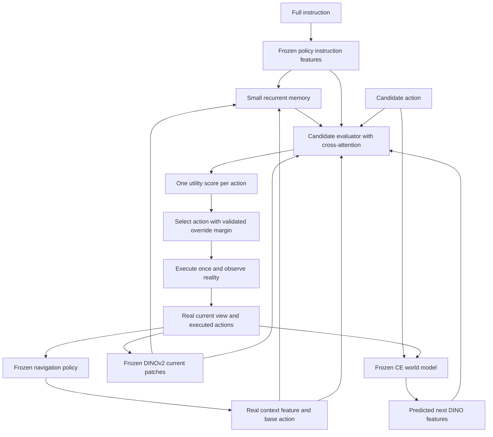

# Scorer design

23 October 2026 · Architecture compatibility revision · CE performance untested

**Build a small instruction-conditioned action-value model with real-history memory.** It answers: *If I take this action now, how useful is the resulting situation for finishing this instruction?* It receives the proposed action and its predicted next view, alongside the instruction and the journey actually experienced. The output is a utility estimate for choosing an action, not a claim that a predicted image proves task completion.

The reference implementation contains **2,890,115 parameters for SmolVLM2, 2,873,603 for OneVision, and 3,170,819 for Qwen3-VL**. These counts cover the scorer only. The navigation VLM, DINOv2, world model, and any VAE are additional costs. No complete 8 GB fit has been established.

Files: [reference model](../Scorer/scorer.py), [configuration](../Scorer/config.json), [model interfaces](../Scorer/interfaces.py), [world-model adapters](../Scorer/world_models.py), [runtime](../Scorer/runtime.py), and [compatibility record](Architecture_Compatibility.md). The feature-level scorer, label arithmetic, prefill hook primitive, world-model boundaries, and logged fallback are implemented. At the architecture revision above, loading the actual trained navigation policies, selecting their concrete hook/processor integration, CE collection, persistent feature caching, and training orchestration remained pending.

Execution update, 27 October 2026: the selected SmolVLM2 policy and DINO world-model pair are frozen.
[Step 6 measured labels](Step6_Run.md) and [Step 7 frozen features](Step7_Run.md) are complete and
verified, including actual-prefix replay inputs and predictions from both DINO models. Step 8
scorer fitting is next; closed-loop scorer performance remains untested.

## 1 The decision we are training it to make

Start with **one-action prediction, H = 1**, and evaluate FORWARD, LEFT, RIGHT, and STOP. Use the action definitions and sizes from the chosen CE task configuration. Internal action integers in the reference code must be explicitly mapped to Habitat's identifiers.

This is a refinement of our earlier short-sequence proposal. Because we execute one action before observing again, the first version predicts and labels exactly that action. It uses a learned estimate of the later outcome, so its objective is not restricted to immediate distance reduction. Longer imagined sequences are a subsequent experiment requiring a matching execution and labeling protocol.

The frozen navigation policy provides the real-context representation and its preferred first action. Score all four unique primitive actions; the base action is therefore always included. Predict only three next views. STOP reuses the current view and has its own action embedding. It means terminate now, with no continuation. Scoring it as another movement would be incorrect.

For example, in “pass the sofa, then turn left,” a plausible left-facing view is insufficient. The scorer must combine the view with evidence that the sofa has already been passed. We give it the information and training comparisons needed to learn this distinction; we do not assume that attention weights certify it.



Only real observations update persistent memory. A rejected future or unexecuted action never becomes part of the actual journey.

## 2 Exact inputs and architecture

Use width d = 256, four attention heads, eight recurrent memory slots, and two candidate attention blocks. Each attention block has a 512-wide feedforward layer. The final MLP is 256 -> 128 -> one scalar per output head.

| Input | Source and shape for one episode | Treatment |
| --- | --- | --- |
| Full instruction T | L token features from the frozen trained navigation VLM | LayerNorm and linear projection from its hidden width to 256; explicit padding mask |
| Real context q_t | Last valid input-token hidden state of the current multimodal policy prompt, before candidate generation | Reuse the same policy projection; respect expanded multimodal positions and left/right padding |
| Current view V_t | 14 x 14 frozen DINOv2-S/14 patch features, width 384, at 196 x 196 encoder input | Average each 2 x 2 patch region, yielding 49 tokens; project to 256 |
| Real memory M_(t-1) | Eight slots of width 256 | Recurrent update once per actual observation |
| Previous executed action | Canonical action ID; START for the initial observation | Learned action embedding |
| Elapsed budget | Executed action count divided by configured maximum episode actions | Linear projection; no privileged scene information |
| Candidate action a | FORWARD, LEFT, RIGHT, or STOP | Learned action embedding in the candidate summary token |
| Predicted next view Vhat_(t+1)^a | Same 49 x 384 feature format as the current view | Shared visual projection, spatial positions, and a future-role embedding |

**Instruction features:** run an instruction-only pass through the trained frozen policy once per episode and cache the final-layer states at instruction-token positions. Use the model's proper prompt template and tokenizer. These causal token states plus the contextual token q_t are pretrained representations, not an oracle instruction parser. Preserve the full instruction within the chosen model's supported context. Never silently truncate the end of an RxR instruction. Record language, token count, and any excluded overlength cases.

**Real-context features:** obtain q_t from the policy's actual observation prefill. `PrefillFeatureTap` captures one call to the actual final decoder norm; `last_valid_state` handles padding using a mask aligned with the expanded multimodal sequence. Calling the hook around multi-step generation is rejected. Native text widths are 960, 896, and 2048 for the locked SmolVLM2, OneVision, and Qwen3-VL models. The selected OneVision checkpoint uses its native LLaVA implementation. Concrete hook paths and processor integration still require validation against each trained policy. Initially reconstruct the bounded real-history prompt after each executed action; only introduce KV-cache reuse after it agrees with replay. Never retain an unexecuted action chunk as completed history.

**Visual features:** use one frozen DINOv2-S/14 encoder and identical feature conventions for real and predicted views. The default now follows the inspected DINO-WM source: resize/crop to 224, normalize with mean/std 0.5, then resize to 196 before encoding, producing 196 raw patches and 49 pooled tokens. The earlier 224-to-256-patch assumption would mismatch this predictor. A 16 x 16 grid remains an explicitly configured alternative; it requires compatible predictor training/weights and a matching scorer. Do not interpolate positional weights silently. [DINO-WM visual model](https://github.com/gaoyuezhou/dino_wm/blob/0a9492fa12044b852ae9e001cc74604b79c8bb0c/models/visual_world_model.py), [image transforms](https://github.com/gaoyuezhou/dino_wm/blob/0a9492fa12044b852ae9e001cc74604b79c8bb0c/datasets/img_transforms.py)

`DinoCommandDynamics` accepts up to three real feature frames, the intervening executed actions, and one F/L/R candidate. It learns a new CE command embedding and reserves zero proprioception channels; source-task command/proprio encoders are replaced. The default predictor width is 404 = 384 visual + 10 proprio + 10 command. Only the last predicted frame's 384 visual channels enter spatial pooling. Transfer uses strict compatible predictor weights, followed by CE adaptation. The fresh DINO baseline uses the same architecture/interface with newly initialized predictor weights.

For CDiT, use four real VAE context frames and an explicitly declared nominal-command vector [x, y, yaw], with CE-consistent normalization. If four real frames are unavailable, keep the base action; do not silently pad context. Apply the same warm-up rule across world models in matched comparisons. An epsilon/learned-variance denoiser returns eight channels; the official diffusion sampler produces the four-channel completed latent. Decode after dividing by 0.18215, convert clamped [-1,1] pixels to [0,1], then apply the common DINO encoder. The VAE context encoder uses the matching scale. `NWMVisualBridge` uses one shared resize/crop view; for nonsquare inputs this differs from NWM's source resize-to-square and must be retained consistently during CE adaptation. Native VAE latents and denoiser outputs cannot be passed directly to the DINO projection. Exact source checkpoints, encoder revision, and sampling budget remain unverified/unselected. [NWM inference](https://github.com/facebookresearch/nwm/blob/3f6cd8e70d6f2d1e2b9684acff510710135f0f41/isolated_nwm_infer.py)

**Actual-history update:** construct a source sequence C_t from projected instruction tokens, current visual tokens, q_t, and a previous-action/time token. Add role embeddings and fixed 2D visual position embeddings. Eight distinct learned slot queries attend to this source. A shared GRUCell updates the slots:

```text
update_t = CrossAttention(LayerNorm(M_(t-1) + slot_queries), C_t)
update_t = update_t + FeedForward(update_t)
M_t      = GRUCell(update_t, M_(t-1))     # same GRU applied to each slot
```

Reset M to zero at the start of each episode. The recurrent update makes order representable; it does not guarantee retention of every landmark. The eight-slot capacity is a testable efficiency choice. Compare against no recurrent memory and, if long RxR routes fail, a larger memory budget.

**Candidate evaluation:** form a 50-token candidate sequence: one action-summary token and 49 predicted visual tokens. Each of two blocks applies self-attention within that candidate, cross-attention to [C_t, M_t], and a feedforward layer. Read the final summary token through the MLP. Candidates share weights and are evaluated independently, possibly batched. Their order and the presence of another candidate must not change their individual scores. Sequence lengths and positions derive from the configured grid. Cached BF16/FP16 features are converted to the scorer's device and dtype before projection.

The three heads are:

1. **Utility:** the primary action-selection output, trained against the outcome target below.
2. **Eventual success logit:** an auxiliary prediction of terminal success under the specified continuation policy.
3. **Immediate collision logit:** an auxiliary prediction for a forward command, using the actual simulator collision event. A collision does not necessarily mean zero displacement; sliding behavior depends on the simulator configuration.

Only the utility head determines the candidate ordering. The other heads provide additional supervision and diagnostics. Their sigmoid outputs must be checked for calibration before being described as reliable probabilities. An MLP-only ablation and removal of both auxiliary heads remain necessary controls.

## 3 Labels from actual CE outcomes

Define h_t as the full actual episode prefix and I as the instruction. For each action a at a saved root, execute a in the real simulator and then let the same frozen navigation policy pi_ref continue from the resulting real observation until STOP or the configured episode limit. pi_ref uses one-action replanning and receives the original instruction. It does not use scorer reranking or an oracle expert.

The conceptual target is:

```text
Q_ref(I, h_t, a) = E[U(actual completed trajectory)
                       | take a now, then follow frozen pi_ref]
```

The learned scorer receives a compressed real history and a model-predicted next view, so it can only approximate this target from available evidence. With a deterministic policy and simulator, one branch gives the outcome of that particular continuation. With stochastic continuations, repeated rollouts estimate variation; one sample is not a calibrated probability estimate. The deployed reranking policy also differs from pi_ref, requiring a separate closed-loop evaluation.

**Initial utility target:**

```text
U = 0.70 S + 0.30 N - 0.01 (n / B) - 0.02 (c / B)
```

- S: official terminal success under the configured CE evaluator, including its STOP/termination rule.
- N: official nDTW of the **complete actual path, including the already executed prefix**, against the instruction's reference trajectory.
- n: number of executed actions from this branch root to termination, including the candidate and any executed STOP.
- c: number of forward collision events during that same remainder.
- B: configured maximum actions for the entire episode, held constant within a task configuration. Every branch retains the original remaining budget.

These weights are an explicit starting design, not an experimentally optimized reward. nDTW is retained even for failures so unsuccessful branches can still differ in route fidelity. For an individual realized outcome, a success scores at least 0.67 and a failure at most 0.30 under the stated bounds. This arithmetic does not make expected-utility selection lexicographic in success probability and does not guarantee better SR. Report SR, SPL, nDTW, SDTW, and costs separately; test weight sensitivity on development scenes.

nDTW measures ordered trajectory similarity, not the truth of every language clause. It may penalize a valid alternative route. The reference is used only to construct labels and metrics, never as an inference input. The original metric paper motivates order-sensitive route comparison. The pinned CE implementation uses its stored reference locations, Euclidean distances, and the configured DTW variant; it skips consecutive identical positions. Reuse the evaluator rather than substituting a geodesic formula or a discrete-graph trajectory. [nDTW paper](https://arxiv.org/abs/1907.05446), [CE NDTW/SDTW implementation, lines 237–314](https://github.com/jacobkrantz/VLN-CE/blob/729d141b2ee10628061ada74dd3a5b9f70faeba5/habitat_extensions/measures.py#L237-L314)

Goal-distance change alone is unsuitable for the main target: instructions can require detours, and a turn can improve the subsequent route without moving position. LAW documents the mismatch between shortest-goal supervision and instruction following in CE. Our use of route evidence is motivated by that issue; our composite target is our own proposed design. [LAW, Section 3](https://aclanthology.org/2021.emnlp-main.328.pdf)

### Branch collection rules

1. Save the real history, task/scene/episode identity, instruction, simulator pose and state, action count, metric state, random states, and frozen policy cache. Replay from the episode start if reliable state cloning is unavailable.
2. Restore the identical root before each candidate. Execute only that candidate first action. For STOP, terminate immediately without a continuation.
3. Continue the frozen policy on real observations. Discard unexecuted tokens in an old action chunk and keep the adapter's cache consistent with the forced action.
4. Stop at the original task budget. Do not grant every branch a fresh full-length episode. Compute whole-path metrics with the original prefix restored.
5. Store actual first-next observations, completed outcomes, immediate collision flags, reference/configuration versions, and continuation-policy checkpoint identity. Labels are tied to that policy and schedule.

Never label a candidate using just its imagined distance, an LLM's opinion, or the outcome of an action sequence we will not execute. Future realized pose and collision outcomes are supervision, not world-model/scorer inputs at inference.

## 4 Training procedure

Keep the navigation policy, DINO encoder, VAE, and world models frozen during scorer training. Train the projections, attention blocks, recurrent memory, MLP, and output heads.

The default scorer detaches external features while retaining recurrent gradients across real steps. Batched episode resets clear only the corresponding memory rows. An explicit `future_grad=True` mode permits gradients into future features only with an evaluated, frozen scorer; it detaches real context and gives STOP no future gradient. This is an interface provision, not a new world-model objective. The NWM inference sampler remains no-grad; end-to-end differentiation through diffusion is not implemented or implied.

Use a pilot split of CE **training scenes** into A for policy/world-model fitting, B for scorer fitting, and C for development/calibration. Group shared R2R/RxR scene IDs together before splitting. All actor/WM training and DAgger collection in this pilot must respect A. This deliberately reduced-data pilot is not a full-training-data benchmark result. Final unseen evaluation scenes cannot select hyperparameters. If expanding later to more training scenes, use out-of-fold predictions or document a separate protocol rather than silently training the world model on all scorer development transitions.

Replay real prefixes to produce M_t under the current scorer parameters. Cache frozen input features, not stale trainable memory states. Initially backpropagate through the last 32 real steps; process earlier prefix steps without gradients and detach the memory at the truncation boundary. Every training root still receives its actual earlier history.

For each labeled root/action, construct both actual-next-view features and predicted-next-view features. A proposed curriculum first trains on actual features to test scorer capacity, then trains on a mixture of actual and predicted features, finishing on predicted features for deployment. Use the same actual outcome label for each representation. Validate their errors separately.

For the four-world-model comparison, pool equally sampled predictions from the four frozen models for the same labeled root/actions. Fit **one scorer per navigation policy**, then hold its exact weights fixed across that policy's world-model trials. Supply no world-model identity. If one model's weights are unavailable, call the experiment an available-model comparison. Adding another model later requires a clearly versioned pooled scorer and rerunning the comparisons. Separately tuned scorers are a secondary practical-system comparison.

Use the following initial loss, averaged over roots/actions:

```text
L = MSE(predicted_utility, U)
    + 0.1 BCEWithLogits(success_logit, S)
    + 0.1 BCEWithLogits(collision_logit, immediate_collision)
```

Apply the collision term only to FORWARD candidates. No separate ranking loss is needed initially. Squared error has a conditional-mean target in the unconstrained population setting; this finite shared network need not attain it. A success head is not a substitute for utility regression. Measure ranking regret even though training uses regression.

Proposed optimizer starting point: AdamW, learning rate 1e-4, weight decay 0.01, eight roots per batch with all four actions, gradient clipping at norm 1.0. These settings have not been tuned or run on CE. Select checkpoints using held-out utility regret and closed-loop navigation results, not training fit. Cache frozen features and train the small scorer without keeping all large models resident together.

If most roots have no successful continuation, report that distribution and the best-candidate advantage over pi_ref. Include valid expert-prefix and policy-visited roots from the permitted training scenes to improve coverage. Keep deployment-distribution evaluation separate. Do not manufacture success labels or silently change to expert continuations.

Do not declare randomly swapped instructions to be negatives. They can be paraphrases or share valid actions. Any semantic negative needs a valid task/reference and recomputed or manually verified outcome interpretation. Existing GELA and Landmark-RxR annotations are not automatically available in our CE data. [GELA dossier](references/dossiers/gela.md), [Landmark-RxR dossier](references/dossiers/landmark_rxr.md)

## 5 Action selection and reliability

Begin with one future sample per non-STOP candidate and a recorded sampling seed. Do not choose the most optimistic sample from many diffusion outputs. A later multiple-sample study should report aggregation, ranking stability, and full added compute.

Let a_base be the frozen policy's preferred first action and a_best maximize estimated utility. Override a_base only when its estimated gain exceeds a development-selected margin delta >= 0. On a tie, keep a_base. The runtime now keeps the base action and logs prediction errors, invalid feature shapes, and nonfinite scores. `override_margin: null` disables overrides and skips world-model calls entirely. This handles prediction/scoring failures after valid policy features are available; it is not recovery from a failed policy or simulator. The runtime enforces one observation update and one executed-action commit per real step, with explicit reset after STOP.

Select delta using held-out branch outcomes **and closed-loop episodes**. Until such validation exists, keep overrides disabled; there is no established safe numeric margin. A margin is a heuristic, not calibrated uncertainty or a formal performance guarantee.

After execution, update the navigation policy cache and scorer memory with the actual action and observed view. The agent replans; none of the imagined future is committed. The scorer can be wrong because the world model hallucinates a landmark, its memory forgets route order, or pi_ref's continuation labels poorly represent the new policy's visited states. Measure these causes separately.

## 6 Decisive evaluation before expanding the system

Start by collecting **64 roots from at least eight training episodes**, using a mixture of legal expert prefixes and the frozen policy's actual histories. Branch all four actions, giving 256 measured continuations. This is a collection/debugging pilot, not a sufficient training set or statistical benchmark. Record the number of distinct outcomes, label gaps, timeouts, successes, and candidate gains over the base action. It will reveal whether a one-step choice can influence outcomes enough to justify a larger collection.

| Test | Question it resolves |
| --- | --- |
| Oracle selection using measured labels | Does this candidate set offer improvement over the base action at these roots? This uses privileged labels and is only a diagnostic. |
| Scorer with actual next views | Can the small evaluator rank useful states before adding prediction errors? |
| Same-capacity scorer with no future input | Does explicit world-model prediction add value beyond instruction, real history, and candidate action? |
| Predicted versus actual next views | How much decision quality is lost through world-model errors? |
| Within-root future permutation among non-STOP actions | Does the trained scorer actually use the predicted action consequences? This is a diagnostic mismatch, not an achievable policy baseline. |
| History ablation and instruction ablation | Does the system depend on the information it claims to use? Remove the corresponding policy-context information too, or leakage defeats the ablation. |
| Curated legal CE tasks with route-order distinctions | Can it distinguish “before” from “after” a landmark? Verify references/labels manually; do not infer comprehension from an attention plot. |
| Fixed-policy closed-loop comparisons | Does reranking improve SR, SPL, nDTW, SDTW, and collision/step cost on held-out scenes? |
| Full pipeline profiling | Are policy inference, predictions, VAE decoding, DINO encoding, and scoring affordable on the actual GPU? |

For no-future controls retain the same action/context pathways and attention capacity, substituting a learned null future; do not accidentally provide actual future features. For explicit-memory ablations, distinguish removal of the added recurrent memory from removal of history in q_t. Those test different claims. For instruction ablations, regenerate both text and policy-context features without the instruction.

Report mean action regret U(best measured candidate) - U(selected candidate), action-ranking accuracy excluding declared near-ties, success-head calibration, and results by route length, language, collision setting, and scene. Confidence intervals should resample episodes or scenes, not correlated individual branches alone. The final closed-loop policy can visit different states, so branch ranking is not a navigation result.

Keep the policy checkpoint, sensing, candidate actions, replanning schedule, label protocol, scorer weights, and randomization protocol fixed in each world-model comparison. Compare the original chunk schedule separately. Include extra world-model data, decoding cost, and repeated samples in the resource accounting.

**Stop conditions:** if actual-next-view scoring fails, improve the scorer/data before expanding world-model training. If the no-future control matches the full system, the claimed benefit of predictive features is unsupported. If the best measured candidate offers little lift, change the horizon/candidate design with a new labeling protocol. If improvements disappear at matched runtime, reconsider the added complexity.

## 7 Evidence status and research contribution

Executed: [check_design.py](../Scorer/check_design.py) passed 13 grouped CPU checks using Python 3.13.7 and PyTorch 2.9.0+cpu. Checks cover the three input widths, finite gradients, frozen-input boundaries, candidate independence, padding behavior, STOP identity, real-memory immutability during scoring, memory order sensitivity, recurrent gradients, fallback margins/ties, patch pooling, and utility bounds. Exact source hashes and parameter counts are in [check_results.json](../Scorer/check_results.json).

Additional checks execute the actual pinned six-layer DINO predictor, CDiT-S/2 denoiser, and official NWM diffusion sampler on CPU with random initialization. They cover configuration, mixed-dtype feature boundaries, conditional visual extraction, masks, gradient routing, fallback, and episode lifecycle. See [compatibility results](../Scorer/compatibility_results.json) for measured outcomes and scope. Policy-hook, VAE, and DINO-encoder checks use explicitly labeled test doubles or saved metadata.

Not executed: pretrained VLM feature extraction, actual pretrained DINO/VAE encoding, CE branch collection, released world-model checkpoint inference, scorer training on navigation data, GPU profiling, or benchmark evaluation. Passing these checks demonstrates interface behavior, not language understanding, prediction quality, navigation improvement, or an 8 GB fit. [Architecture compatibility](Architecture_Compatibility.md) records remaining integration requirements.

This architecture is a defensible baseline, not itself a verified novel contribution. Recurrent instruction grounding and progress monitoring have prior art, including the [Self-Monitoring Navigation Agent](https://arxiv.org/abs/1901.03035). The earlier investigation also found value-aware model learning precedents. Our research claim must come from demonstrated CE decision benefits, a carefully isolated predictive mechanism, and any subsequent contribution beyond this baseline.

Our previous [DREAMWALKER](references/dossiers/dreamwalker.md), [HNR](references/dossiers/hnr.md), and [DINO-WM](references/dossiers/dinowm.md) audits motivate separating future-prediction error from action-value error. This scorer design does that through actual-future diagnostics, matched no-future controls, and labels from measured CE continuations. It does not claim that those papers used this exact architecture or utility.

The full instruction remains available; explicit instruction splitting is deferred. We have not introduced a new text generator, an LLM reward judge, a new navigation backbone trial, or a fifth world-model family. The locked three policies and agreed four world-model trials remain as recorded in [Backbone Trials](../manifest/Backbone_Trials.json) and [World Model Trials](../manifest/World_Model_Trials.json).
