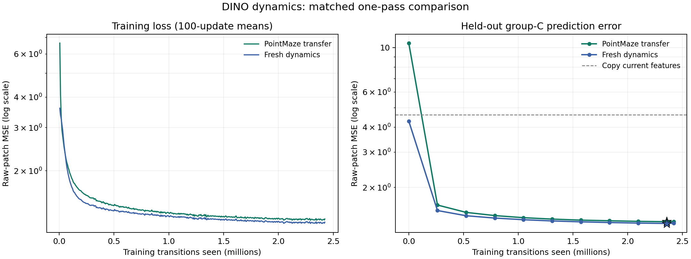

# Step 5A complete — DINO transfer and fresh dynamics

Completed: 2026-10-26T01:00:29.434329+00:00

Both trials used the same frozen native DINOv2-S/14 encoder, new CE action embedding initialization, group-A samples, shuffled order, optimizer, learning-rate schedule and full-pass training budget. Only predictor initialization differed.

Each trial trained on 2,422,469 matched transitions for 37,852 optimizer updates. Checkpoints were selected by mean feature-prediction MSE across six dataset/action groups in 3,072 fixed group-C expert-path samples.

| Trial | Initial C MSE | Selected update | Selected C MSE | Copy-current C MSE |
| --- | ---: | ---: | ---: | ---: |
| transfer | 10.539087 | 36,864 | 1.347414 | 4.611210 |
| fresh | 4.292558 | 36,864 | 1.320767 | 4.611210 |

Fresh dynamics had lower held-out error in this single matched run. Both models beat the copy-current baseline in all six dataset/action groups; both selected bundles are retained. Each training pass took about 57.7 minutes.

Stars mark selected checkpoints. [Vector figure](learning_curves.svg). Training loss uses logged windows; validation uses the fixed group-C set.

The transferred predictor is the author’s released PointMaze checkpoint, loaded strictly. Its three-frame, 404-channel, six-layer architecture matches the fresh control. Wall’s released one-frame predictor is incompatible with this fixed interface. Source action/proprio encoders, decoder and optimizer were excluded.

Release provenance: the [author’s mirror](https://huggingface.co/datasets/gaoyuezhou/dino_wm) archive matched the original OSF SHA-256. Exact source/weight identities are in `assets/download_provenance.json` and `assets/transfer_selection.json`.

All 175 native DINO encoder tensors equal the previously pinned Hugging Face weights. Native position interpolation is retained. Features were computed in float32 and stored as float16 after a precision check; both trials share the same immutable cache.

Selected bundles: `frozen/dinowm_transfer/` and `frozen/dinov2_fresh_dynamics/`, with shared `frozen/encoder/`. Load through `wm.frozen.FrozenDinoWorldModel` with the selected policy identity. Require four actual observations before prediction; the DINO model receives the last three. STOP uses current features without a dynamics call.

The navigation policy remains refined SmolVLM2 checkpoint 512 with STOP logit bias −0.25. Its deliberate selection despite the failed stopping safeguard is retained; the original Step 2 control is unchanged.

[Final verification](final_verification.json) passed: strict checkpoint loading, sample/action alignment, group separation, native/SDPA output and gradient parity, optimizer restart, frozen encoder/model state, and packaged model validation replay.

Limit: validation uses held-out expert paths and contains no blocked forward examples. Group-A training retains those failures. Feature prediction error and command sensitivity do not establish downstream navigation success or benefit from scorer overrides.

The DINO pair is ready for Step 6 scorer-label collection. NWM/CDiT remains the later paired repeat; no group-B labels, group-E final evaluation, or scorer training were performed in this step.

[Training methods](../../docs/Step5_Run.md) describe data, precision and selection. Frozen configurations: [transfer](frozen/dinowm_transfer/config.json), [fresh](frozen/dinov2_fresh_dynamics/config.json), [shared encoder identity](frozen/encoder/encoder_identity.json).
