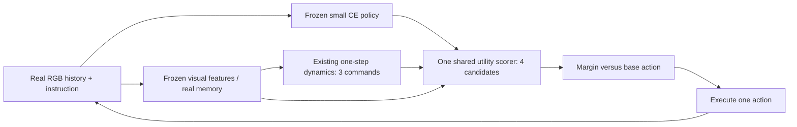

# Proposal v2 — Outcome-grounded prediction for instruction-conditioned action selection

Version: **v2, 2026-10-23**. Supersedes v1 for recommendation; v1 remains preserved. Author: coordinator, Assignment 8. Revised after independent initial A9/A10 findings; the exact v2 hash is submitted to those same reviewers for recheck. This document describes a conditional research candidate and the evidence threshold for advancing it. It does **not** assert that two novel contributions or benchmark improvements have been established. Original materials remain unchanged.

## Compact CVPR candidate

**Problem.** A lightweight, RGB, instruction-conditioned CE policy can select the wrong primitive action even when another primitive followed by the same policy would produce a better instruction-following outcome. Earlier CE planning work supports the broad importance of future evaluation, but this specific failure and its prevalence on the three selected small policies remain unmeasured. The proposed cause is that generic visual/geometric prediction quality can disagree with instruction-conditioned action value. This cause is a hypothesis, not an observed fact in the supplied project.

**Central hypothesis.** On roots with reproducible action-value opportunity and usable predicted visual consequences, training the existing predictor to preserve measured instruction-conditioned value differences will improve action choices beyond an equally supervised direct value model and ordinary prediction, at a useful total inference cost.

**Two contribution targets, with their present limits:**

1. **A controlled scientific finding about instruction-conditioned outcome/proxy ordering, with semantics separately validated.** Establish when measured instruction-following action values disagree with geometric/deviation-based ranking, and whether a predicted-next-feature channel retains information useful to a finite critic after controlling for history, action identity, supervision and computation. This is an empirical finding to establish, not a new generic oracle/permutation protocol. World4Scorer already uses candidate interventions and fixed-state permutation controls; MCR already studies task-relevant ordering. Beyond Next-Screen Prediction (arXiv:2610.24372v1, 17 October 2026) already defines matched direct-versus-predicted decision value in GUI tasks. Neither that protocol nor its transfer to CE alone is claimed new. A meaningful result needs reproducible prevalence, consequences and generalization on ordinary held-out CE roots, not selected anecdotes.
2. **An outcome-grounded predictor adaptation for that measured failure.** Within the same existing world model and scorer, replace a geometry-derived task surrogate with measured instruction-conditioned continuation-value contrasts, retaining the native prediction objective. The precise distinction from MCR is the source and semantics of supervision; from World4Scorer it is the frozen CE instruction/history critic, exhaustive primitive actions and reference-policy whole-path return. VAML/IterVAML already establish value-aware fitting. The loss below is centered regression, not a newly invented ranking principle. Its scientific value depends on correcting the failure in target 1 beyond those close alternatives.

These are complementary possible contributions within one argument: establish a consequential mismatch, then correct it with a minimal intervention. Neither has supporting CE results here. If target 1 is merely an expected application-specific observation, or target 2 reduces empirically to ordinary reweighting/direct value learning, **the requested two-contribution target remains unmet**. No third contribution is proposed.

**Complete method.** Train one of the agreed small navigation backbones, then freeze it. At each real observation, retain the full allowed instruction/context and real-history memory, obtain one predicted next feature for FORWARD, LEFT and RIGHT, and reuse the current feature for STOP. One shared small critic scores the four candidates using actual-branch continuation returns as supervision. After demonstrating that this predictive channel is useful, freeze the critic and adapt only the existing deterministic DINO dynamics predictor with its native prediction loss plus one centered action-value residual loss. At deployment, choose the best candidate only when its held-out-calibrated advantage over the base action exceeds a margin; otherwise execute the base action. Update memory only after a real observation. The margin is empirical, not a certificate.

**Minimum decisive experiments:** verify branch replay; estimate candidate opportunity without noisy-max optimism; compare actual-next and predicted-next critics against matched no-future/current-copy/tiny-predictor controls; only then test one dynamics objective against native and established task-weighted alternatives. Closed-loop unseen-scene outcomes and full runtime are required before a paper claim. A 64-root/eight-episode run is integration debugging only.

## 1. Formal contract and information flow

Let `h_t` contain the real observation/action prefix, remaining budget and metric prefix; `I` is the complete instruction. The deployed networks see legal representations `x_t` of that history, not simulator pose, reference route, future RGB or outcomes. Simulator state and route annotations may construct training/evaluation labels. `A={F,L,R,STOP}`, `K=4`, `a_0` is the coupled base action. A trained, frozen one-action policy is `pi_ref`.

For candidate `a`, actually branch once and then follow `pi_ref` to termination with the original remaining budget. The label is a repeat-mean estimate `y_a` of

`Q_ref(I,h_t,a) = E[ .70 S + .30 nDTW_whole_path - .01 n_remaining/B - .02 c_remaining/B | h_t, force a, then pi_ref ]`.

If continuation is verified deterministic, one exact branch is sufficient for that fixed root/protocol. Otherwise estimate means using declared seed sets; evaluate selected actions on independent continuation seeds. No imagined sample is paired with a real stochastic outcome as though it predicted that draw.

The world model predicts physical consequences, **without requiring instruction-conditioned dynamics**: `Zhat_a=F_phi(native real visual history, command a)`. The critic is instruction-conditioned: `s_a=S_theta(x_t,a,Zhat_a)`. STOP has `Zhat_STOP=Z_t` and no WM call. Thus the same physical prediction can receive different utilities under different valid instructions. No added language parser, goal detector, graph, extra critic, search loop or learned gate is required.

The original scorer uses 64 pooled tokens of width 384, a 256-wide projection, eight 256-wide real-memory slots and two candidate-attention blocks. A6 found that the inspected DINO-WM default instead produces **14×14** raw patches through a 196-pixel encoder input. If the chosen checkpoint confirms this contract, preserve its native grid and pool to **7×7=49** tokens for every actual/predicted source. Do not silently reshape 196 patches into 256. This is an interface correction conditional on checkpoint selection, not novelty. CDiT comparisons must decode to RGB and use the identical encoder/grid; their extra cost is measured separately.

## 2. Training and deployment

The original three policy/four WM registry is preserved. Start with one policy and one deterministic DINO pair to make the hypothesis affordable; transferred/fresh CDiT and the remaining policies are later robustness comparisons after early gates pass.

1. **Actor and branch data.** Establish the StreamVLN-style trained small-policy baseline and the native-chunk versus forced-H1 control. Separate observation handling from committing an executed action. Initially replay prefixes from reset rather than trust opaque copied simulator/KV caches. Freeze the actor and its exact decoding rule.
2. **Qualify the scorer and predictive channel.** Fit the existing critic with actual-branch labels; use actual-next inputs only as a privileged diagnostic/curriculum and finish the deployed critic on predicted inputs. Compare utility-only training with the original success/collision auxiliaries; the minimal candidate uses utility alone unless the auxiliaries show distinct held-out value. Preserve the same full allowed context and labels in no-future controls. Freeze this qualified critic before dynamics adaptation.
3. **One conditional adaptation.** On permitted dynamics-fitting scenes, train only `phi` with the scalar objective below; keep the scorer/visual encoder/actor fixed. Branch labels for these scenes are an additional data cost and must also be available to matched direct-value/weighting controls. Scorer fitting uses B scenes and dynamics adaptation uses A branches, but the frozen B-fitted critic transmits B supervision indirectly into phi. This deliberately relaxes strict native-WM-A/scorer-B statistical isolation; it is legal training-data reuse, not unseen-evaluation leakage. Count both A and B labels in the adaptation's supervision budget and provide direct/weighting rivals the same permissible union. Development scenes select margins and loss weight. R2R/RxR share scene grouping to prevent cross-dataset scene leakage.
4. **Deployment.** Observe reality once; update real context/memory once; predict three candidate features; score four actions jointly; compare against the same coupled base action; commit the executed action to future history. Imagined features never enter real memory. Invalid/nonfinite predictions or scores fall back to the base action. This fallback is a proposed integration fix: the supplied helper currently raises rather than providing it.

There is one new loss weight `lambda`, selected with a fixed small development budget matched across rivals. There is no mandatory alternating optimization or repeated scorer refit. If the frozen critic becomes inaccurate after adaptation, the candidate fails its qualification test; do not silently repair it with unreported stages.

## 3. The single adaptation objective and its limits

At a complete root, let `s_phi=(s_F,s_L,s_R,s_STOP)`, `y=(y_F,y_L,y_R,y_STOP)` and `P=I_K-11^T/K`. Use

`L(phi) = L_native(phi) + lambda E_roots[ ||P(s_phi-y)||_2^2 / K ]`.

The task term targets relative expected utility, cancelling root-common offsets. It is exactly proportional to all-pairs squared gap regression: `sum_(a<b)[(s_a-s_b)-(y_a-y_b)]^2 = K ||P(s-y)||^2`. It supplies **no new labels beyond y**, and is not itself a separate contribution. Native loss anchors physical prediction but does not guarantee truthful features or prevent critic exploitation. Do not claim perceptual accuracy and decision accuracy must trade off; either may improve or worsen.

The intended gradient is `J_F^T J_S^T P(s-y)` up to loss scaling, plus the native gradient. Freezing `theta` is compatible with nonzero gradients through its input. The supplied scorer detaches future inputs, so an explicit opt-in differentiable route is required **only for this extension**. Frozen DINO encoding of real targets remains detached; predicted features must retain their differentiable path. No gradients should reach actor/critic parameters or train-only labels. CDiT would additionally require differentiable denoising-estimate, VAE and DINO paths, with sampler-surrogate mismatch and memory cost; it is excluded from the first adaptation test.

**Conditional regret statement, derived rather than new theory.** If `y` were the true expected action values and `ahat=argmax s`, then `y_best-y_ahat <= sqrt(2)||P(s-y)||`. This is a per-root algebraic inequality. Finite training loss on noisy labels does not imply generalization, closed-loop improvement or a uniform error bound.

**Why it could help.** A native model with finite capacity may allocate error to action-dependent consequences that its fixed critic needs for instruction value. If those consequences are predictable, the critic is accurate near both real and predicted features, and real outcome order differs from the geometric proxy, the added gradient can prioritize those consequences without a new module. A minimal helpful setting has two observable/predictable candidate features, an instruction-conditioned critic that correctly values them, and a native approximation error reversing the values; a small feature correction across the critic's boundary fixes the choice. The decisive prediction is improved held-out action ordering specifically on predeclared semantic/geometric disagreement roots, beyond weighted native training.

**Why it can fail.** The critic may ignore futures; useful information may be absent from history; the relevant consequence may emerge after H1; labels may reflect unobservable stochastic continuation rather than predictable visual differences; the critic may be wrong, saturated or exploitable; native and task gradients may conflict; reranking may shift visited histories outside training support. If a no-future critic or tiny predictor matches the effect, expensive imagination has not earned its cost.

For stochastic model extension, with independent model gap `D` and outcome gap `Y`, `E[(D-Y)^2]=(E D-E Y)^2+Var(D)+Var(Y)`. Minimization suppresses score variance as well as mean error. CVAML already analyzes this issue. This v2 does not claim calibrated generative training or introduce a two-sample correction merely to add novelty; deterministic DINO is the first bounded case.

## 4. Contribution-specific evidence and controls

| Target | Precise remaining difference | Evidence presently available | Decisive analysis / control | Cost and simplification criterion |
|---|---|---|---|---|
| C1 Semantic ordering and predictive usefulness finding | Matched CE instruction/history/primitive roots, geometric proxy versus measured full-continuation value; use ordinary held-out roots and valid route-stage subsets | Published adjacent failures; no project-specific prevalence or utility measurements | Split-seed ordering; same-label no-future/full-history critic; current copy; permutation; tiny predictor; neutral/full-instruction history controls; prespecified disagreement versus agreement subsets | Simulator branches dominate cost; no added model. If mismatches are rare, predictability absent or direct value suffices, do not elevate a diagnostic protocol into a contribution |
| C2 Outcome-grounded adaptation | Measured instruction-conditioned expected gaps instead of MCR's dead-reckoned perturbation ordering, in a fixed-critic CE system; all generic value-aware ingredients acknowledged | Mathematical contract and local gradient check only; no adapted predictor | Native loss, centered/squared implementation equivalence, simple per-action weighted native loss, MCR-style proxy where well-defined, VaGraM-style real-feature weighting, outcome-weighted feature-contrast rival; same data/scorer/training budget; then closed-loop | One lambda and differentiable scorer-input route, no network addition. A simpler equal-cost loss matching performance defeats the claimed need for this adaptation |

This is a small comparison ladder, not a demand to train every combination. Native/direct-value controls come first; closest objective rivals become necessary only if the conditional adaptation is promising. Report which external method was faithfully reproduced and which is a labeled local adaptation. An infeasible replica is not a defeated baseline.

## 5. Experimental and resource contract

The detailed, preregistrable staged protocol is [Assignment 7](assignments/07_experiments.md). All model/data/tuning partitions are frozen before held-out outcomes. Generalization is across scenes/episodes, not 256 correlated branches. Separate positive, negative and underpowered outcomes. The initial debug bundle checks command mapping, STOP, budget/prefix nDTW, policy cache, deterministic replay, grid shape and train/inference information. It does not train or select a method.

The first scientific go/no-go asks whether alternative primitives provide reproducible held-out-seed lift over the same reference policy. The next asks whether actual-next and then predicted-next features improve a matched direct critic. Actual-next performance is a privileged diagnostic, **not a guaranteed numerical ceiling**. Negative actual-next results can indicate either absent signal or an inadequate critic; diagnose fitting/calibration before rejecting all predictive approaches. Positive actual-next results do not establish that a model can predict the useful signal.

Only after these gates, run C2 and report ranking regret/calibration, model-seed sensitivity, real-feature error, native loss, and closed-loop success/SPL/nDTW/sDTW/length/collisions/STOP/override rates. Compare native versus H1 actor schedules and equal total compute. A larger direct policy, more direct-value training or training-only future distillation is a cost rival. Occupancy refresh with unchanged `pi_ref` labels is a targeted coverage control if deployment shifts roots, not a new contribution or a required theoretical change of continuation policy.

The probed host has an 8,188 MiB RTX4070 Laptop GPU and 31.7 GiB system RAM, but the inspected Python3.13 environment has CPU-only Torch and no Habitat/Habitat-Sim. No trained navigation adapters, selected WM weights, scoped CE assets or GPU pipeline were available in this run. A6's scorer-only synthetic checks and CPU profile do not establish full 8 GB feasibility. Staging actor collection, feature encoding and scorer fitting helps offline memory; online residency/latency still must be measured. Record total WM sampling steps, decoder/encoder work and model loading/transfer overhead, not scorer latency alone.

## 6. Changes from the original and boundary of the decision

| Original element | Diagnosed issue / opportunity | v2 treatment | New assumption or cost | Decisive test |
|---|---|---|---|---|
| Frozen policy + three imagined movement views + STOP + real memory | Coherent; specific future benefit unmeasured | Preserve as reference and conditional deployment core | None beyond original | Matched direct critic and real/predicted channel tests |
| General future-usefulness extension left undefined | Generic value-aware and ranking methods already exist | Specify one centered measured-outcome objective, explicitly inherited | Qualified frozen critic; extra scene-A branch labels; one lambda | Native/weighted/MCR/VaGraM rivals and semantic-ordering correction |
| Fixed 16×16 raw feature contract | Inspected DINO default is14×14 | Conditional native14×14→7×7 common adapter | Must select/check actual checkpoint first | Real model encoding and all-source shape parity |
| Utility + success/collision auxiliary losses | Distinct benefit not established | Utility-only minimal candidate; original auxiliary variant remains control | Could reduce fit; evaluate fairly | Removal/replacement of auxiliary losses |
| Actual→mixed→predicted scorer training | Actual/predicted conditional meanings differ | Preserve final predicted-input qualification; do not equate critics | Extra calibration diagnostics | Crossed model/continuation seeds |
| Best measured branch in a small pilot | Sample maximum can exaggerate opportunity | Determinism test or repeated/split-seed means | Additional rollouts if stochastic | Independent selected-action utility |
| Margin helper raises on invalid values | Online fallback not implemented | Base-action fallback in eventual adapter | Integration code | Invalid-input controlled check |
| All three policies/four WM families | Full grid before evidence is costly | Preserve registry, stage comparisons | External validity initially narrow | Expand only after conditional gates |

This is a **mechanism refinement** of the original objective, not a pivot to active sensing or a replacement task. Training-only distillation would be an explicitly labeled deployment pivot if it later wins. No research objective is declared invalid merely because the current paper-sized contribution target is unestablished.

Evidence that would justify investment: a consequential, reproducible CE ordering mismatch; predictive utility beyond strong direct/history controls; adaptation benefit attributable to measured semantic outcomes and retained in closed loop at acceptable cost. Evidence against the mechanism: no reproducible candidate opportunity, no predictive signal after adequate fitting, a simpler control matching the effect, or cost exceeding equally effective direct alternatives. Reviewers should independently assess both this conditional candidate and whether its evidence threshold is sufficient.

## 7. Independent-review corrections incorporated in v2

**Scope of C1.** Success and nDTW are benchmark outcomes with geometric components, not independent measurements of instruction-clause compliance. A disagreement between U and a geometric proxy is initially only an **outcome/proxy mismatch**. Calling it semantic requires additional evidence that a valid change in instruction or route stage changes the correct ordering while the relevant physical conditions are controlled. Do not construct arbitrary shuffled or contradictory instruction negatives and assume their labels are valid.

**Primary geometric diagnostic, fixed before outcomes.** For the three movement branches use privileged actual next position p_a and reference goal g to define `G_a=[d_geo(p_t,g)-d_geo(p_a,g)]/d_step`, larger meaning more immediate geodesic progress. This is a diagnostic available to the label pipeline, never a deployed input. Report the unnormalized distances too. It intentionally has no heading preference: LEFT/RIGHT often tie, and those ties are not reversals. Predeclare a distance-resolution tolerance (initial planning default 0.01 m, verified against simulator precision before outcomes). Count a strict reversal only when the geometry difference exceeds that tolerance, the measured expected-utility difference exceeds the declared 0.01 utility/noise criterion, and their signs oppose. Report all-root prevalence, coverage of strictly ordered pairs, tie-resolved pairs and uncertain pairs separately. STOP is a separate terminal-decision stratum evaluated with official success/STOP criteria; it is not assigned an arbitrary movement-progress score.

The 0.01 m geometry tolerance applies to the **unnormalized progress difference** (equivalently, divide it by d_step when comparing G values), so its units agree. This simple goal-progress diagnostic is **not** a reproduction of MCR's expert-trajectory perturbation cost and cannot establish superiority over MCR. Before any such comparison, implement and pin the applicable published trajectory-deviation rule, horizon, reference alignment, orientation handling, STOP domain and tie policy; label an adapted H1 version as an adaptation. If a fair port is unavailable, report that limitation rather than a defeated baseline. Findings driven only by the obvious turning/STOP blind spots of immediate progress do not earn C1.

**Independent semantic evidence.** On a separately reported subset, obtain valid route-stage/next-action annotations from the original instruction and route, by annotators blind to candidate model scores and test outcomes. State annotation rules, disagreements and coverage. Prefer matched real roots with different valid instructions or naturally different route stages; recompute valid reference metrics and branch labels for each task. Compare complete instruction/history against predeclared neutral/reminder and history-representation controls without treating invalid ablations as ground-truth tasks. A contribution needs prevalence on the ordinary held-out root sample and an effect beyond these trivial proxy blind spots. If only benchmark-target mismatch is established, narrow the result and leave the semantic contribution target unmet.

**Fair inputs and held-out qualification.** The no-future critic receives the union of legal real frames/actions available to the world model and scorer, with any additional encoder capacity/cost reported. Matching only the compressed policy context is insufficient if the WM has richer history. After dynamics adaptation, use independent measured outcomes, ranking/selection lift and closed-loop behavior to qualify the unchanged critic; a lower critic loss alone cannot pass. No automatic scorer refit or second critic is introduced.

**Fresh closest work.** [Beyond Next-Screen Prediction](https://arxiv.org/html/2610.24372v1) §3.1 Eq.1, §3.3 and §5.3 explicitly compares matched direct and prediction-augmented ranking. It uses reference-action labels in GUI tasks, unlike actual CE continuation returns here. It constrains generic diagnostic novelty without establishing the CE result. A10 also checked [RIWANav](https://arxiv.org/html/2610.08640v1) §III-C, Eqs.4–7: geometry/novelty-weighted native dynamics training is relevant to the simple weighting rival, not the same frozen-critic measured-return objective. Both are inspected preprints, not verified accepted publications.

**Unresolved design disagreement.** A7 prefers outcome-weighted real-feature contrast as the first objective because it avoids optimizing an extrapolating critic. The coordinator retains centered score residual as the central candidate because it directly tests measured utility alignment, but requires that cheaper rival even without visible exploitation. Evidence may select the simpler alternative; adding both is not the default. Neither currently clears the two-contribution threshold.

